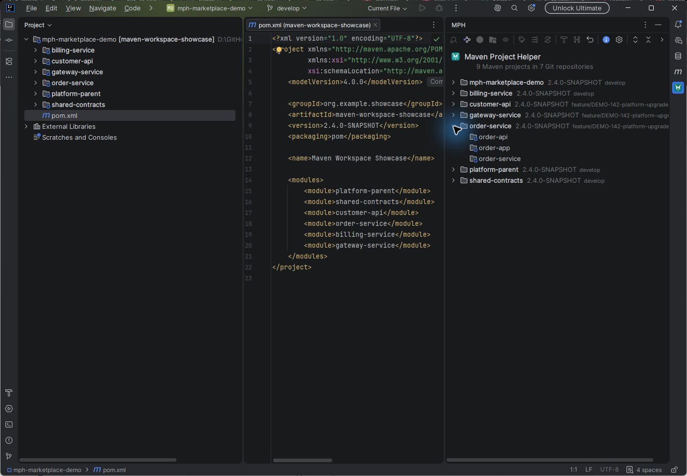
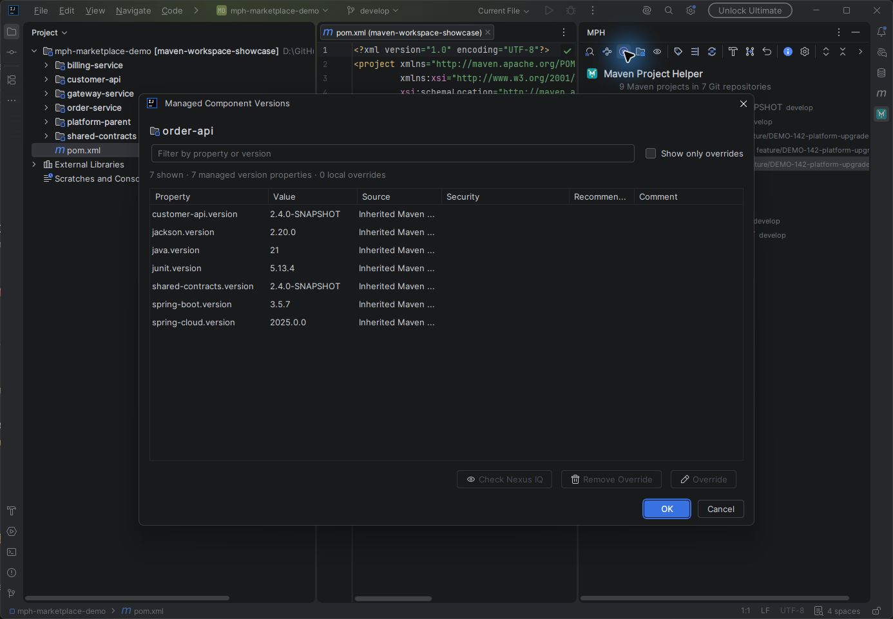
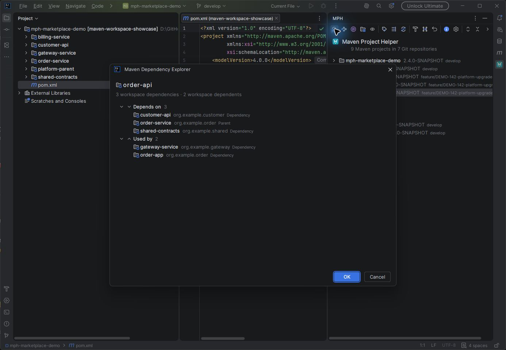
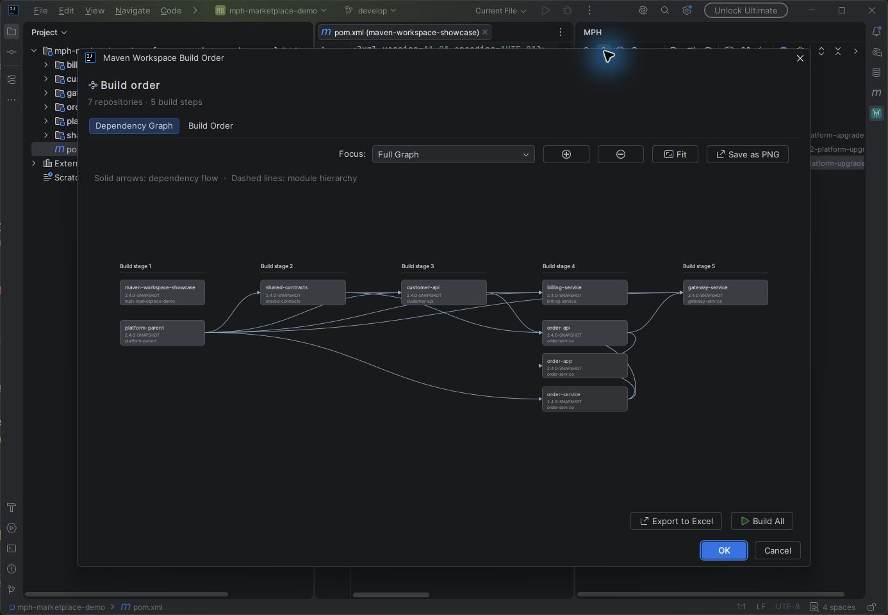
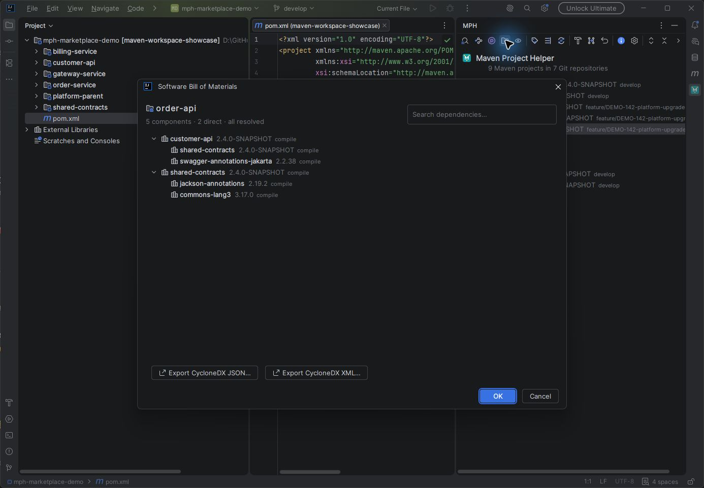

# Maven Project Helper

[](https://sonarcloud.io/summary/new_code?id=mrhoeve_mph)
[](https://sonarcloud.io/summary/new_code?id=mrhoeve_mph)

Maven Project Helper (MPH) is an IntelliJ IDEA plugin for developers working with many related Maven repositories and multi-module projects. It uses IntelliJ's linked Maven projects and Git roots directly, so there is no separate server or web application to start.

## Screenshots

### One workspace for every Maven repository



| Managed component versions | Workspace dependencies |
| --- | --- |
|  |  |

| Dependency-aware build order | Searchable software bill of materials |
| --- | --- |
|  |  |

## Capabilities

- Discover and group all linked Maven projects and modules by Git repository.
- Explore workspace dependencies and dependents, open POMs, and focus interactive dependency graphs.
- Calculate dependency-aware build stages, run Maven builds, and export build plans to Excel or graphs to PNG.
- Update project versions, add or remove shared upgrade prefixes, and realign dependent references.
- Inspect managed properties and coordinate Spring Boot upgrades.
- Synchronize prefixed feature branches safely with `origin/develop` while preserving committed, staged, unstaged, and untracked work.
- Generate searchable CycloneDX SBOMs as JSON or XML.
- Run Nexus IQ evaluations using application IDs from Jenkins pipeline definitions.
- Store Nexus IQ credentials in IntelliJ Password Safe and reuse each developer's Maven settings, mirrors, credentials, and local repository.

See the [plugin documentation](intellij-plugin/README.md) for complete usage and recovery guidance.

## Local build

The plugin requires JDK 21. Run the complete local verification build from the repository root:

```powershell
.\build-local.cmd
```

`build-local.cmd` and `build-plugin-local.cmd` are equivalent. They locate JDK 21, run all plugin tests with Kover coverage, build the installable ZIP, and verify compatibility with every supported IntelliJ IDEA line. Use `-SkipVerification` for a faster test/package cycle or `-SkipClean` to retain incremental Gradle outputs.

For a custom JDK location:

```powershell
.\build-local.cmd -JavaHome 'D:\path\to\jdk-21'
$env:MPH_JAVA_HOME_21 = 'D:\path\to\jdk-21'
```

To run a local SonarQube analysis, store the token in 1Password and expose it only for the build through `SONAR_TOKEN`, or put only the token in the git-ignored `.sonar-token` file. Then run:

```powershell
.\build-local.cmd -Sonar
```

The default server is `https://sonarqube.hictsapps.nl`. Override settings when required:

```powershell
.\build-local.cmd -Sonar `
  -SonarHostUrl 'https://sonarqube.example.org' `
  -SonarProjectKey 'example_project' `
  -SonarProjectName 'Example Project'
```

The token stays in the process environment and is never passed as a command-line argument, logged, or committed.

## Continuous integration

Every push and pull request runs one plugin-only workflow that:

1. tests the plugin and generates Kover coverage;
2. builds the installable ZIP;
3. runs JetBrains Plugin Verifier against the supported IDEA versions;
4. analyzes the plugin with SonarQube Cloud and waits for the Quality Gate.

Successful pushes to branches other than `main` replace that branch's mutable GitHub prerelease with a verified plugin snapshot. Pull requests can be protected by requiring the **Build, test, and analyze** check.

Configure `SONAR_TOKEN` as a repository secret and `SONAR_ORGANIZATION` plus `SONAR_PROJECT_KEY` as repository variables. Do not store the token as a GitHub variable.

## Releases

Production releases are started manually from `develop` through the **Release** workflow. The workflow verifies the exact commit, signs the verified plugin, creates a release commit and tag on `main`, advances `develop` to the next `-SNAPSHOT` version, and publishes the same signed IntelliJ plugin ZIP to GitHub Releases and, after the initial Marketplace registration, JetBrains Marketplace.

The workflow uses a GitHub App with only **Contents: Read and write** permission. Store its client ID as `RELEASE_APP_CLIENT_ID` and private key as `RELEASE_APP_PRIVATE_KEY` in the protected `release` environment. The app is the only ruleset bypass for the atomic `main`, `develop`, and tag update.

### JetBrains Marketplace bootstrap

JetBrains requires the first plugin version to be uploaded manually so its Marketplace listing can be configured. For the first release:

1. Create or select a JetBrains Marketplace vendor profile and accept the Marketplace Developer Agreement.
2. Start the **Release** workflow from `develop` with `marketplace_mode` set to `bootstrap`.
3. Download the signed plugin ZIP from the resulting GitHub Release.
4. In JetBrains Marketplace, choose **Upload plugin**, select the vendor, and upload that ZIP.
5. Configure the MIT license, source repository, issue tracker, Maven-related tags, and the default Stable channel, then submit the plugin for approval.

After JetBrains has created the plugin entry, use `marketplace_mode: publish` for every later release. IntelliJ IDEA then receives approved updates through its normal plugin update mechanism.

The protected GitHub `release` environment must contain these secrets:

| Secret | Purpose |
| --- | --- |
| `JETBRAINS_CERTIFICATE_CHAIN` | PEM certificate chain used to sign the plugin. |
| `JETBRAINS_PRIVATE_KEY` | PEM private signing key. |
| `JETBRAINS_PRIVATE_KEY_PASSWORD` | Password protecting the signing key. |
| `JETBRAINS_MARKETPLACE_TOKEN` | Permanent token from the Marketplace profile's **My Tokens** tab. |

Keep the token, private key, password, and certificate in 1Password as their source of truth. Copy them directly from 1Password into the GitHub environment secrets; never store them in repository files, workflow artifacts, shell history, or release assets.

See the [complete Marketplace setup and release guide](intellij-plugin/docs/marketplace-publishing.md) for certificate generation, the first manual upload, later automatic updates, and recovery guidance.

## License

This project is licensed under the [MIT License](LICENSE).

Issues and feature requests can be reported through the [GitHub issue tracker](https://github.com/mrhoeve/mph/issues).
